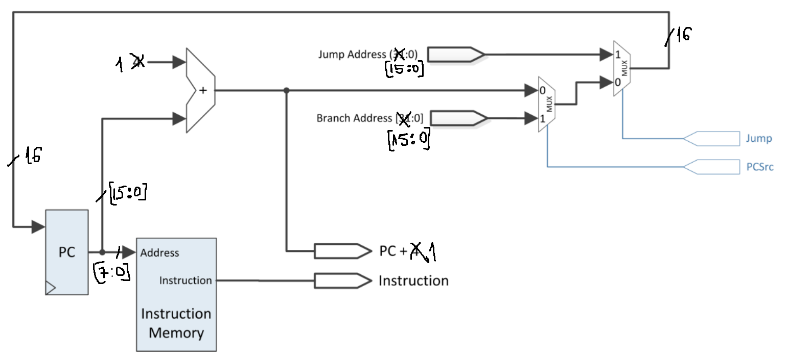

# MIPS-Lite

A 16-bit, single-cycle MIPS processor written in VHDL and run on a **Nexys A7** FPGA board (Xilinx Vivado).
It implements a reduced MIPS instruction set with 16-bit instructions, 8 registers and a separate
instruction ROM and data RAM. The board's buttons, switches, LEDs and 7-segment display are used to step
through programs one instruction at a time and inspect every internal signal.

Built for the Computer Architecture course at the Technical University of Cluj-Napoca (2026).



## Datapath

| Unit | File | What it does |
|---|---|---|
| Instruction Fetch | `inst_fetch.vhd` | Program counter, instruction ROM, next-PC logic for branches and jumps |
| Instruction Decode | `instr_decode.vhd` | Register file access, sign/zero extension of the immediate, `func` and `sa` fields |
| Register File | `reg_file.vhd` | 8 × 16-bit registers, 2 read ports, 1 synchronous write port |
| Control Unit | `control_unit.vhd` | Decodes the 3-bit opcode into the datapath control signals |
| Execution Unit | `exec_unit.vhd` | ALU, ALU control, branch target address and zero flag |
| Memory Unit | `mem_unit.vhd`, `rams_no_change.vhd` | Data RAM for `lw` / `sw` |
| Top level | `top.vhd` | Connects the units, write-back mux and the board I/O |
| Board I/O | `MPG.vhd`, `SSD.vhd` | Button debouncer (mono-pulse generator) and 8-digit 7-segment display driver |

## Instruction set

Every instruction is 16 bits: a 3-bit opcode, then the fields below. Full encodings are in
[`InstrEncodingsMIPS16.md`](InstrEncodingsMIPS16.md).

```
R-type   | opcode(3) | rs(3) | rt(3) | rd(3) | sa(1) | func(3) |
I-type   | opcode(3) | rs(3) | rt(3) |      immediate(7)       |
J-type   | opcode(3) |          target address(13)             |
```

| Type | Instructions |
|---|---|
| R-type (opcode `000`) | `add`, `sub`, `sll`, `srl`, `and`, `or`, `slt`, `xor` |
| I-type | `addi`, `lw`, `sw`, `beq`, `slti`, `ori` |
| J-type | `j` |

**Custom changes to the standard lab set:** `bne` was replaced with `slti` (set on less than immediate),
and `slt` / `xor` were added as R-type functions. This meant extending the ALU and updating the
control unit's signals for the new opcodes.

## Running it on the board

1. Create a Vivado project for the Nexys A7, add all `.vhd` files and set `top.vhd` as the top module.
2. Add a constraints file (`.xdc`) mapping `clk`, `btn`, `sw`, `led`, `an` and `cat` to the board pins
   (the standard Nexys A7 master XDC works).
3. Generate the bitstream and program the board.

| Control | Function |
|---|---|
| `BTN0` | Execute one instruction (step) |
| `BTN1` | Reset the PC to 0 |
| `SW[11:9]` | Signal shown on the **left** 4 digits |
| `SW[6:4]` | Signal shown on the **right** 4 digits |
| `LED[15:0]` | Control unit outputs (ALUOp, RegDst, ExtOp, ALUSrc, Branch, Jump, MemWrite, MemToReg, RegWrite) |

Switch codes for the display: `000` instruction, `001` PC + 1, `010` RD1, `011` RD2,
`100` extended immediate, `101` ALU result, `110` memory data, `111` write-back data.

## Testing

The instruction ROM in `inst_fetch.vhd` holds a test program, and every line is commented with the expected
result, for example:

```
slt  $3, $1, $2    x0b02 < x0c03       => $3 = 1
xor  $2, $6, $4    x123f ^ x0e05       => $2 = x1c3a
ori  $6, $2, 15    x1c3a | x000f       => $6 = x1c3f
```

Stepping through the program with `BTN0` and checking the PC, ALU result and write-back data on the
7-segment display against those expected values confirms each instruction.
